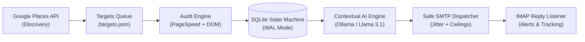

# B2B Prospector — Automated Tech Audit & AI Outreach Pipeline

[](https://www.python.org/)
[-green.svg)](https://www.sqlite.org/)
[](https://ollama.ai/)
[](https://docs.python.org/3/library/asyncio.html)

An asynchronous Python 3.12 lead-discovery and technical auditing pipeline built to automatically identify businesses with poor mobile UX, slow Core Web Vitals, or missing modern web capabilities, and synthesize hyper-personalized, consultative outreach pitches at scale.

---

## Architecture Overview



The pipeline operates as an atomic state machine across five sequential stages:
```
DISCOVERED ──► AUDITED ──► QUALIFIED ──► DRAFTED ──► SENT ──► REPLIED
```

---

## Core Capabilities

### 1. High-Precision Local Discovery (`01_fetch_maps.py`)
- Interfaces with the **Google Places API (New)** using fine-grained field masks (`places.displayName`, `places.websiteUri`, `places.formattedAddress`, `places.rating`) to minimize API consumption.
- Discovers commercial targets across user-defined niches, cities, and language boundaries configured in `targets.json`.

### 2. Deep Performance & DOM Auditing (`02_audit_and_extract.py`)
- Executes non-blocking audits combining the **Google PageSpeed Insights API** and **BeautifulSoup4 DOM analysis**.
- Extracts critical Core Web Vitals metrics:
  - **LCP (Largest Contentful Paint)** & **FCP (First Contentful Paint)**.
  - **CLS (Cumulative Layout Shift)**.
  - Mobile responsiveness, uncompressed hero assets, missing viewport configurations, and third-party platform dependencies.
- Validates corporate domain MX records using `dnspython` to guarantee deliverability.

### 3. Contextual Pitch Synthesis (`03_draft_emails.py`)
- Feeds raw audit findings into a local LLM (**Ollama Llama 3.1 8B**) or cloud models (OpenAI / Anthropic).
- Automatically translates technical metrics into business impact (e.g., explaining how a 4.2s mobile LCP causes high bounce rates in restaurant reservations or dental booking flows).
- Generates individualized, non-templated cold pitches highlighting exact bottleneck URLs and actionable fixes.

### 4. Safe Delivery & Anti-Spam Governance (`04_sender.py`)
- Built-in compliance mechanisms to protect domain reputation:
  - Strict daily volume ceilings (`MAX_DAILY_EMAILS = 25`).
  - Randomized sending jitter (`SEND_DELAY_MIN = 300s` to `SEND_DELAY_MAX = 720s`).
  - Native `--dry-run` inspection mode with terminal visualization using `rich`.

### 5. Reactive Reply Tracking (`05_reply_listener.py`)
- Asynchronous IMAP client polling dedicated inboxes for incoming prospect responses.
- Automatically dispatches instant webhook notifications via Telegram Bot or personal email alerts.

---

## Project Structure

```
├── 01_fetch_maps.py        # Google Places discovery worker
├── 02_audit_and_extract.py  # PageSpeed & DOM auditing worker
├── 03_draft_emails.py       # Contextual LLM pitch synthesizer
├── 04_sender.py             # Rate-limited SMTP dispatcher
├── 05_reply_listener.py     # Background IMAP reply tracker
├── db.py                    # SQLite state machine & schema manager
├── logger_setup.py          # Structured logging configuration
├── main.py                  # CLI orchestration entrypoint
├── targets.json             # Niche and geographic target configuration
├── requirements.txt         # Production dependencies
└── .env.example             # Environment variable template
```

---

## Getting Started

### Prerequisites
- Python 3.12+
- (Optional) [Ollama](https://ollama.ai/) running locally with `llama3.1:8b` pulled.

### Installation

1. **Clone the repository:**
   ```bash
   git clone https://github.com/Axl07s/b2b-tech-audit-pipeline.git
   cd b2b-tech-audit-pipeline
   ```

2. **Set up a virtual environment:**
   ```bash
   python -m venv venv
   source venv/bin/activate  # On Windows: venv\Scripts\activate
   pip install -r requirements.txt
   ```

3. **Configure Environment Variables:**
   ```bash
   cp .env.example .env
   ```
   Fill in your Google API key, LLM configuration, and SMTP/IMAP credentials.

---

## Usage

### 1. Define Target Niches (`targets.json`)
```json
[
  {
    "niche": "dental clinics",
    "city": "Austin",
    "country": "US",
    "lang": "en",
    "processed": false
  }
]
```

### 2. Run the Full Pipeline in Dry-Run Mode
Inspect audit findings and generated AI pitches in console without dispatching emails:
```bash
python main.py --dry-run
```

### 3. Run Pipeline Stages Individually
```bash
# Discover leads
python 01_fetch_maps.py

# Audit discovered websites
python 02_audit_and_extract.py

# Synthesize AI drafts
python 03_draft_emails.py

# Start IMAP listener in background
python 05_reply_listener.py
```

---

## Security & Ethics

- **Zero Credential Exposure:** All API keys, SMTP credentials, and tokens are read strictly from runtime environment variables.
- **Privacy First:** Databases (`leads.db`) and audit logs are excluded from source control.
- **Compliance:** Designed to operate strictly with publicly accessible business contact points in full adherence with CAN-SPAM and rate-limiting best practices.

---

## Author

**Axel Molineros**  
Full-Stack & Automation Engineer  
Portfolio: [contra.com/axel_sm_qlkt8x6n](https://contra.com/axel_sm_qlkt8x6n)  
GitHub: [@Axl07s](https://github.com/Axl07s)
